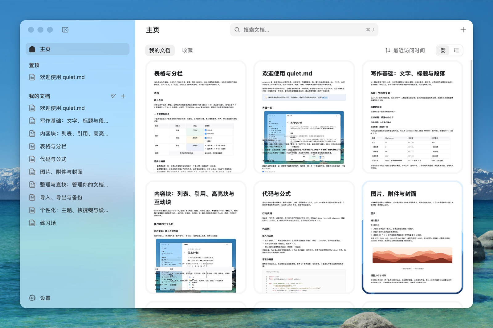

# quiet.md

macOS 上的本地笔记应用：你的每一篇笔记，就是硬盘上的一个文件。

用 Rust 写的原生应用，快、顺手，界面是一点点抠出来的。



## 安装

当前正在准备首次发布。目标最低系统为 macOS 13；架构和系统兼容性以实际发布产物及验证结果为准。

首次发布前可按下文从源码构建。第一次启动会放入一套「开始指南」，每一篇都能照着改。

正式分发包需完成 Developer ID 签名、Apple 公证及 Gatekeeper 校验；当前尚未提供已验证的下载包。

## 为什么用它

**快，因为它真的不是浏览器。** 用 Rust 写，窗口、正文、菜单全部由 GPU 直接绘制，没有 WebView、没有 Electron。百万字的文档里每敲一个键，到文字出现在屏幕上，中位数 4.6 毫秒——输入跟手，滚动不抖，长文档也敢直接往下拖。

**好看，而且是能改的好看。** 侧栏沉在窗口底色里，笔记是贴齐窗口的白色平面，菜单、按钮、圆角、图标尺寸都统一到同一套尺寸上。文档本身有四套主题（Craft、飞书、Notion、Obsidian），也可以自己写一份 CSS——保存之后，所有窗口立刻重画。

**和飞书文档通用。** 飞书导出的 `.xml` 直接打开或导入，高亮块、分栏、表格合并单元格、文字颜色、@文档、日期提醒原样保留；从飞书或网页复制一段内容粘进来，结构也不会散掉。写的时候还是那套熟悉的语法和快捷键：

| 输入 | 变成 |
|---|---|
| `#` + 空格 | 一级标题 |
| `-` + 空格 / `[]` + 空格 | 无序列表 / 待办 |
| `>` + 空格 | 引用 |
| 三个反引号 + 语言名 + 空格 | 代码块 |
| `$$` 公式 `$$` | 公式 |

全部快捷键按 `⌘ /` 看，每一条都能改。

## 能做什么

- **写**：标题、加粗 / 斜体 / 下划线 / 删除线 / 高亮 / 行内代码 / 链接，列表、待办、引用、分隔线、代码块（语法高亮、行号）、公式、表格（可合并单元格）、高亮块、分栏、图片、附件、文件、封面、文档图标。
- **整理**：侧栏文档树、置顶、收藏、主页网格 / 列表两种视图、全文搜索、回收站。
- **导来导去**：导入 Markdown 和飞书 DocxXML，导出 Markdown、PDF，也可以直接打印。
- **不联网**：不需要账号，默认只有你主动加载网络图片时才联网。
- **随时能走**：文档库是普通文件夹，备份、放进 Git、用任何同步工具都行。

## 你的文档在哪

放在 `~/Documents/Quiet.md`（「文稿」里的一个文件夹）。一篇文档一个 XML 文件，索引丢了能重建，格式写在 [docs/FORMAT.md](docs/FORMAT.md)。用环境变量 `QUIET_MD_HOME` 可以换到别处。

## 从源码运行

需要 macOS、Xcode Command Line Tools 和 Rust（版本见 rust-toolchain.toml，rustup 会自动选择）。

```sh
cargo build --release --locked
./target/release/quiet_md                    # 默认用 ~/Documents/Quiet.md
QUIET_MD_HOME=/tmp/lib ./target/release/quiet_md   # 换一个文档库
```

仓库是 Cargo workspace：`crates/core` 是不依赖 GPUI 的文档引擎（`fdl_core`），根目录是应用本体。GPUI 和 taffy 用的是 `vendor/` 里的本地补丁版本，改动见 [vendor/PATCHES.md](vendor/PATCHES.md)。`target/debug` 会长到十几 GB，日常只用 release 时可以 `cargo clean --profile dev` 清掉。

## 构建分发包

`scripts/release.sh` 在本机架构上构建，生成应用图标，使用 Developer ID Application 证书签名，提交 Apple 公证，装订票据并执行 Gatekeeper 校验，最后输出 ZIP 和 SHA-256。它不会上传 GitHub，也不会启动应用。

先在登录钥匙串中安装包含私钥的签名证书，并配置 notarytool 钥匙串 profile，再运行：

```sh
SIGNING_IDENTITY="Developer ID Application: …" NOTARY_PROFILE="quiet-md" scripts/release.sh
```

凭据和证书私钥不得提交到仓库。脚本遇到签名或公证失败会停止，失败目录里的中间产物不可作为正式版本分发。

## 参与开发

```sh
scripts/check.sh                                    # 测试 + clippy 零警告，提交前跑
cargo test --release -p fdl_core                    # 只测文档引擎，不编 GPUI
FDL_FUZZ_SEEDS=2000 cargo test --release random_edits   # 更多随机编辑，查编辑内核
```

- 编辑内核有一个随机测试：从一篇包含所有块类型的文档出发，随机做选区、输入、结构、样式、表格和撤销，每一步检查模型不变量，每 25 步存盘再读回。
- 文档格式有回归测试：`crates/core/tests/fixtures/all-blocks.xml` 读入再写出必须逐字节不变。
- 界面截图和自动化脚本见 [tools/harness/README.md](tools/harness/README.md)。

| 文档 | 内容 |
|---|---|
| [docs/ARCHITECTURE.md](docs/ARCHITECTURE.md) | 分层、编辑流程、不变量、撤销、渲染、模块地图 |
| [docs/FORMAT.md](docs/FORMAT.md) | 文档库目录、索引恢复、DocxXML 读写规则和本地扩展 |
| [docs/THEMES.md](docs/THEMES.md) | 文档主题的 CSS 写法：选择器、属性、命名颜色 |
| [AGENTS.md](AGENTS.md) | 代码风格、提交前检查、测试约定 |

## 许可

MIT，见 [LICENSE](LICENSE)。随附的第三方代码、字体、图标和素材列在 [THIRD_PARTY.md](THIRD_PARTY.md)。

**`assets/icons/` 里的 65 个界面图标不在 MIT 范围内**：它们是 Nucleo 商业授权下的图标，本项目按授权允许的方式（公开源码中最多 100 个）随源码分发。fork 时请自行确认授权，或者换成你自己的图标；不要把它们抽出来做成图标库或图标包。

「quiet.md」这个名字和应用图标不在代码许可之内，fork 时请换掉。
