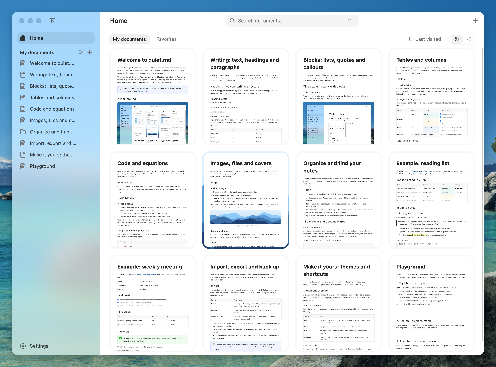

<p align="center">
  
</p>

quiet.md 是一个本地富文本笔记应用，用 Rust 和 GPUI 写成，没有 WebView。每篇笔记是一个 XML 文件，文档库就是一个普通文件夹。没有账号，没有云端，默认不联网。

## 安装

Apple Silicon，最低系统声明为 macOS 13（尚未完成 macOS 13 实机验证）。从 [Releases](https://github.com/s1dashu/quiet-md/releases) 下载 ZIP，解压后把 `quiet.md.app` 拖进「应用程序」。发布包已签名并通过 Apple 公证。

首次启动只在空文档库中初始化「开始指南」，不会覆盖已有笔记。当前下载版本为 v0.1.0；main 分支包含尚未发布的界面、指南和平台支持更新。

Intel Mac 和 Windows 暂时没有安装包，可以[从源码构建](CONTRIBUTING.md#从源码构建)。Windows 版暂不支持全局快捷键、PDF 导出和打印。

## 功能

- **编辑**：标题、列表、待办、引用、代码块（语法高亮）、公式、表格（可合并单元格）、高亮块、分栏、图片、附件、封面。支持 `#`、`-`、`[]`、`>` 这类 Markdown 快捷输入。
- **整理**：文档树、置顶、收藏、全文搜索、回收站。
- **导入导出**：导入 Markdown 和飞书 DocxXML，导出 Markdown、PDF，可直接打印。从飞书或网页粘贴时保留结构。
- **快捷键**：按 `⌘ /` 查看，都能改。
- **主题**：内置四套，也可以自己写 CSS，见 [docs/THEMES.md](docs/THEMES.md)。

## 百万字文档实测

| 操作 | 帧处理 P50 | 帧处理 P95 |
|---|---:|---:|
| 连续输入 | **5.06 ms** | 5.89 ms |
| 连续退格 | **4.97 ms** | 5.64 ms |
| 连续滚动 | **2.36 ms** | 4.63 ms |

2026-11-02 · Apple M5 Pro / 48 GiB · macOS 26.5 · Release 构建 · 100 万字混合内容 · 每项 100 次。统计应用内同步帧处理耗时，不包含屏幕呈现延迟；单机实测，不代表所有设备或竞品对比。

<details>
<summary>测试口径与复现</summary>

源码版本：`66acbc9`。使用 [样例生成器](tools/promo/gen_library.py) 生成 1,001,307 字符、549 章的文档，包含段落、列表、表格和代码；Craft 主题，窗口 1280 × 800 pt，2× 缩放。输入测试在首段末尾依次插入 100 个 `x`，随后退格 100 次，再向下滚动 100 次。

[harness](tools/harness/README.md) 每次发送一次操作后同步调用 `window.draw`；表中使用日志的 `frame`，P50 为中位数，P95 为第 95 百分位。该值包括帧内处理，不等同于键盘到屏幕的端到端延迟。

```sh
cargo build --release --locked
python3 tools/promo/gen_library.py /tmp/quiet-perf/library
# 在临时文档库中使用 Craft 主题
printf '{"english":true,"theme":"craft"}\n' > /tmp/quiet-perf/library/preferences.json
python3 tools/harness/run.py tools/harness/examples/readme-performance.txt /tmp/quiet-perf/library /tmp/quiet-perf/run
```

本次原始输出（ms）：

```text
bench "type x" x100: step [p50 0.03 p95 0.04 max 8.53] frame [p50 5.06 p95 5.89 max 7.37] editor render [p50 3.69 p95 4.32 max 5.33] ms
bench "key backspace" x100: step [p50 0.02 p95 0.03 max 3.75] frame [p50 4.97 p95 5.64 max 6.02] editor render [p50 3.64 p95 4.22 max 4.54] ms
bench "wheel 900 500 40" x100: step [p50 0.01 p95 0.02 max 0.15] frame [p50 2.36 p95 4.63 max 5.55] editor render [p50 0.03 p95 0.05 max 0.08] ms
```

</details>

## 文档库

默认在 `~/Documents/Quiet.md`，可以用环境变量 `QUIET_MD_HOME` 换位置。

```
Quiet.md/
├── format.json    目录布局版本
├── index.json     文档索引，丢了能重建
├── settings.json  窗口状态
├── preferences.json  语言、主题与应用偏好
├── docs/          每篇文档一份 XML
├── assets/        图片与附件
├── themes/        自定义主题（可选）
└── trash/         回收站
```

保存是原子的（先写临时文件再改名），保存失败会在顶栏提示。可以直接用 Git 或任何同步工具管理这个文件夹。格式说明见 [docs/FORMAT.md](docs/FORMAT.md)。

## 参与开发

构建、测试和打包见 [CONTRIBUTING.md](CONTRIBUTING.md)。

## 许可

代码使用 MIT 许可，见 [LICENSE](LICENSE)。第三方代码、字体、图标和素材列在 [THIRD_PARTY.md](THIRD_PARTY.md)。

两个例外：

- `assets/icons/` 里的 67 个 Nucleo 图标使用 Nucleo 商业授权，不在 MIT 范围内。fork 时请自行确认授权或换成自己的图标，不要把它们单独提取出来再分发。
- 「quiet.md」这个名字和应用图标不在许可范围内，fork 时请换掉。
