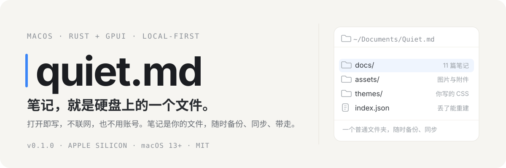
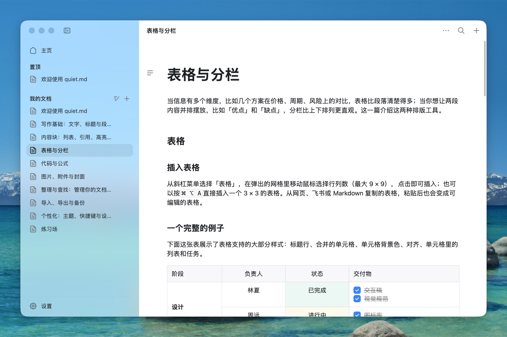

<p align="center">
  
</p>

quiet.md 是一个本地富文本笔记应用，用 Rust 和 GPUI 写成，没有 WebView。每篇笔记是一个 XML 文件，文档库就是一个普通文件夹。没有账号，没有云端，默认不联网。

<p align="center">
  
</p>

## 安装

macOS 13 及以上，Apple Silicon。从 [Releases](https://github.com/s1dashu/quiet-md/releases) 下载 ZIP，解压后把 `quiet.md.app` 拖进「应用程序」。发布包已签名并通过 Apple 公证。

第一次打开时会放入一套「开始指南」。

Intel Mac 和 Windows 暂时没有安装包，可以[从源码构建](CONTRIBUTING.md#从源码构建)。Windows 版暂不支持全局快捷键、PDF 导出和打印。

## 功能

- **编辑**：标题、列表、待办、引用、代码块（语法高亮）、公式、表格（可合并单元格）、高亮块、分栏、图片、附件、封面。支持 `#`、`-`、`[]`、`>` 这类 Markdown 快捷输入。
- **整理**：文档树、置顶、收藏、全文搜索、回收站。
- **导入导出**：导入 Markdown 和飞书 DocxXML，导出 Markdown、PDF，可直接打印。从飞书或网页粘贴时保留结构。
- **快捷键**：按 `⌘ /` 查看，都能改。
- **主题**：内置四套，也可以自己写 CSS，见 [docs/THEMES.md](docs/THEMES.md)。

百万字的文档里，按键到文字上屏的中位延迟约 4.6 毫秒。

## 文档库

默认在 `~/Documents/Quiet.md`，可以用环境变量 `QUIET_MD_HOME` 换位置。

```
Quiet.md/
├── format.json    目录布局版本
├── index.json     文档索引，丢了能重建
├── settings.json  窗口与外观设置
├── docs/          每篇文档一份 XML
├── assets/        图片与附件
├── themes/        自定义主题（可选）
└── trash/         回收站
```

保存是原子的（先写临时文件再改名），保存失败会在顶栏提示。可以直接用 Git 或任何同步工具管理这个文件夹。格式说明见 [docs/FORMAT.md](docs/FORMAT.md)。

## 参与开发

构建、测试和打包见 [CONTRIBUTING.md](CONTRIBUTING.md)。

## 许可

代码使用 MIT 许可，见 [LICENSE](LICENSE)。第三方代码、字体、图标和素材列在 [THIRD_PARTY.md](THIRD_PARTY.md)。

两个例外：

- `assets/icons/` 里的 67 个 Nucleo 图标使用 Nucleo 商业授权，不在 MIT 范围内。fork 时请自行确认授权或换成自己的图标，不要把它们单独提取出来再分发。
- 「quiet.md」这个名字和应用图标不在许可范围内，fork 时请换掉。
